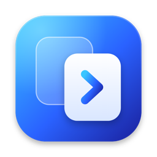
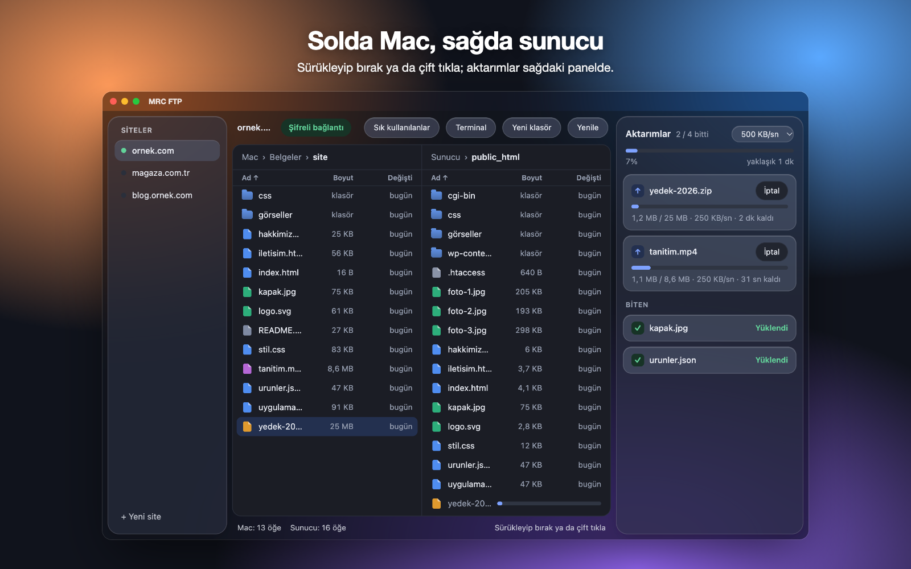
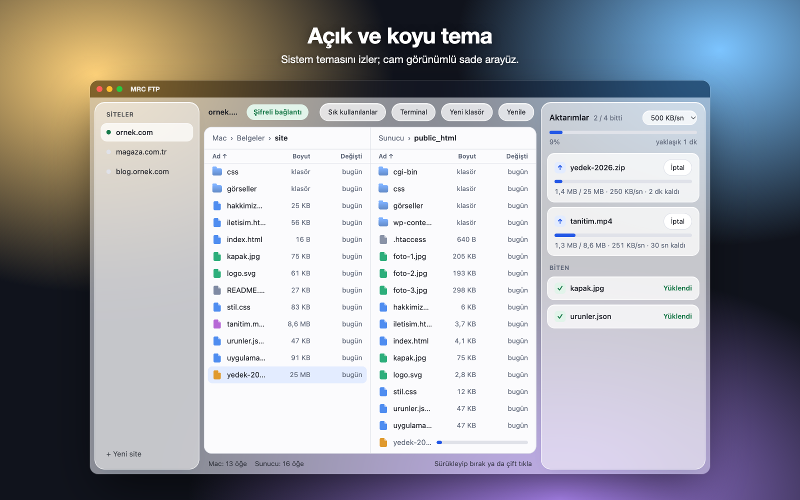
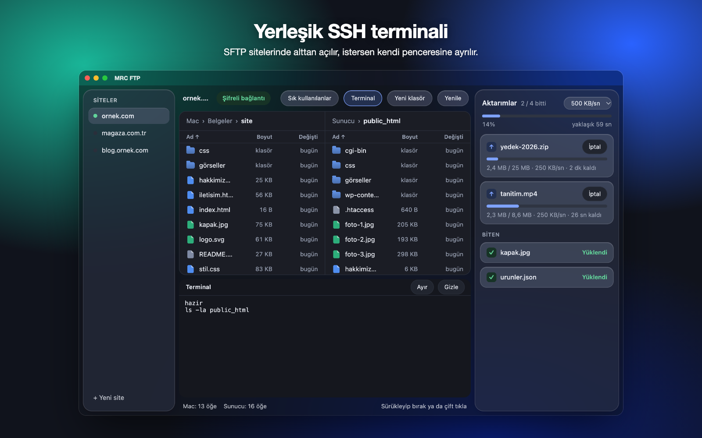
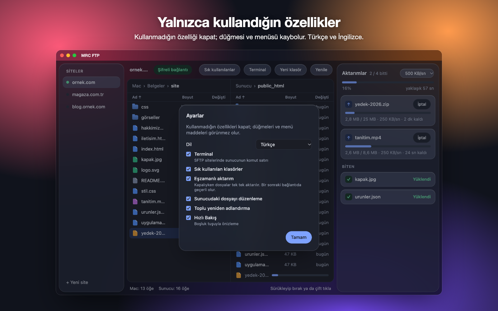
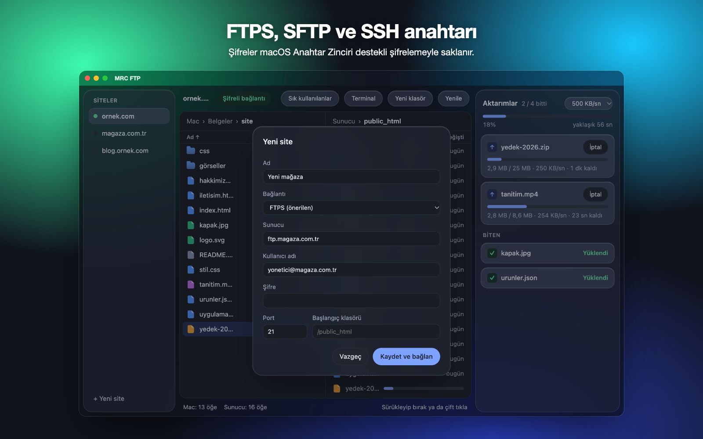
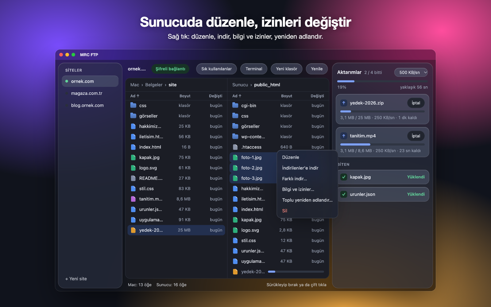
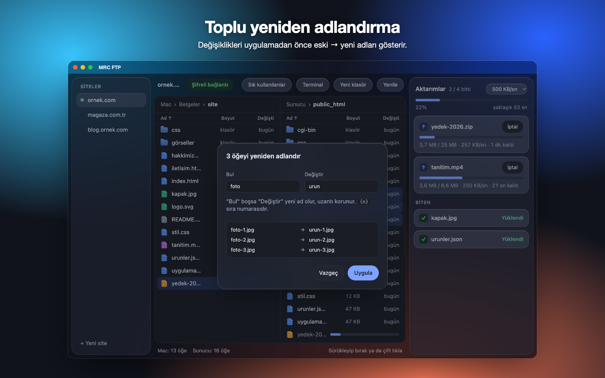

<p align="center"></p>

# MRC FTP

**Mac için sade, hızlı ve açık kaynak FTP / FTPS / SFTP istemcisi.**

cPanel hostingine bağlan, dosyalarını sürükleyip bırak, işin bitsin. Solda Mac'in, sağda sunucun; arada kaybolacağın menüler yok. Ücretsiz ve açık kaynak (MIT).



## Neden MRC FTP?

- **Sade:** iki panel, bir aktarım listesi. Kullanmadığın özelliği Ayarlar'dan kapatırsın, düğmesi de kaybolur.
- **Güvenli:** şifreler macOS Anahtar Zinciri destekli şifrelemeyle saklanır; tanınmayan sunucuya şifre gönderilmeden önce sorulur.
- **Dayanıklı:** yarım dosya bırakmaz, bağlantı koparsa kaldığı yerden sürdürür.
- **Türkçe:** arayüz, menüler ve hata mesajları baştan sona Türkçe; istersen İngilizce.

## Ekran görüntüleri

| | |
|---|---|
|  |  |
|  |  |
|  |  |

Görsellerdeki pencere uygulamanın kendi ekran görüntüsüdür; arka plan ve başlıklar tanıtım için eklenmiştir.

## Kurulum

1. [Son sürüm](https://github.com/halilmeric/mrc-ftp/releases/latest) sayfasından `.dmg` dosyasını indir (Apple Silicon Mac'ler için).
2. Dosyayı aç ve MRC FTP'yi Uygulamalar klasörüne sürükle.
3. İlk açılışta macOS "geliştiricisi doğrulanamadı" uyarısı verir, çünkü paket henüz Apple tarafından imzalanıp onaylanmadı. Uygulamayı bir kez açmayı dene, sonra Sistem Ayarları › Gizlilik ve Güvenlik bölümünde "Yine de Aç" de.

Kaynaktan derlemek istersen aşağıdaki "Geliştirme" bölümüne bak.

## Özellikler

- Solda Mac, sağda sunucu; sürükleyip bırak ya da çift tıkla.
- Aktarımlar sağdaki panelde: ilerleme, iptal, yeniden dene, aynı adlı dosya sorusu.
- Şifreler macOS Keychain destekli şifrelemeyle saklanır.
- Sunucu sertifikası doğrulanamazsa bağlanmadan önce sorar; şifre ondan önce gönderilmez.
- Yarım dosya bırakmaz: aktarım geçici bir ada yazılır, bitince asıl ada taşınır.
- Bağlantı koparsa "Yeniden dene" kaldığı yerden sürdürür.
- Sunucudaki dosyayı kendi editöründe düzenle: sağ tık › Düzenle; her kayıtta geri yüklenir, dosya sunucuda değiştiyse önce sorar.
- Dosya izinleri (chmod): sağ tık › Bilgi ve izinler.
- Boşluk tuşuyla Hızlı Bakış; ok tuşları ve Enter ile gezinme.
- Aynı anda üç dosya aktarır; sunucu bağlantı sınırına takılırsa kendiliğinden azaltır. Aktarım panelinden hız sınırı.
- Sık kullanılan sunucu klasörleri (üst çubuk) ve toplu yeniden adlandırma (birden çok öğe seçip sağ tık).
- Sekmeler: aynı anda birden çok siteye bağlı kal (⌘T; site listesinde ⌘-tık ya da sağ tık › Yeni sekmede aç). Her sekmenin kendi kuyruğu ve terminali var.
- İki dil: Türkçe ve İngilizce. İlk açılışta sistem dilini izler; Ayarlar'dan değiştirilir.
- Ayarlar (⌘,): kullanmadığın özellikleri kapat (terminal, sık kullanılanlar, eşzamanlı aktarım, düzenleme, toplu yeniden adlandırma, Hızlı Bakış); düğmeleri ve menü maddeleri görünmez olur.
- SFTP (SSH): şifre ya da SSH anahtarıyla giriş; sunucu anahtarının parmak izi ilk bağlantıda sorulur, değişirse bağlanmaz.
- Terminal (yalnızca SFTP sitelerinde): altta açılır (⌃`), "Ayır" ile kendi penceresine çıkar; oturum kopmaz.

## Geliştirme

```bash
npm install
npm start      # uygulamayı aç
npm test       # testler (yerel test FTP ve SSH sunucularına karşı)
npm run dist   # dist/ altında .dmg üret (Apple Silicon)
```

Elle denemek için yerel test sunucusu: `node test/helpers/server.js --tls --port 2121` (kullanıcı `test`, şifre `test`). SFTP ve terminal için: `node test/helpers/ssh-server.js --port 2222`.

## Kurulum

`dist/` altındaki `.dmg` dosyasını aç, MRC FTP'yi Uygulamalar klasörüne sürükle.

Uygulama Apple tarafından imzalanmamıştır (yalnızca ad-hoc imza). Derlendiği Mac'te doğrudan açılır. Başka bir Mac'te ilk açılışta macOS engeller: **Sistem Ayarları › Gizlilik ve Güvenlik › Yine de aç**.

## Lisans

MIT
